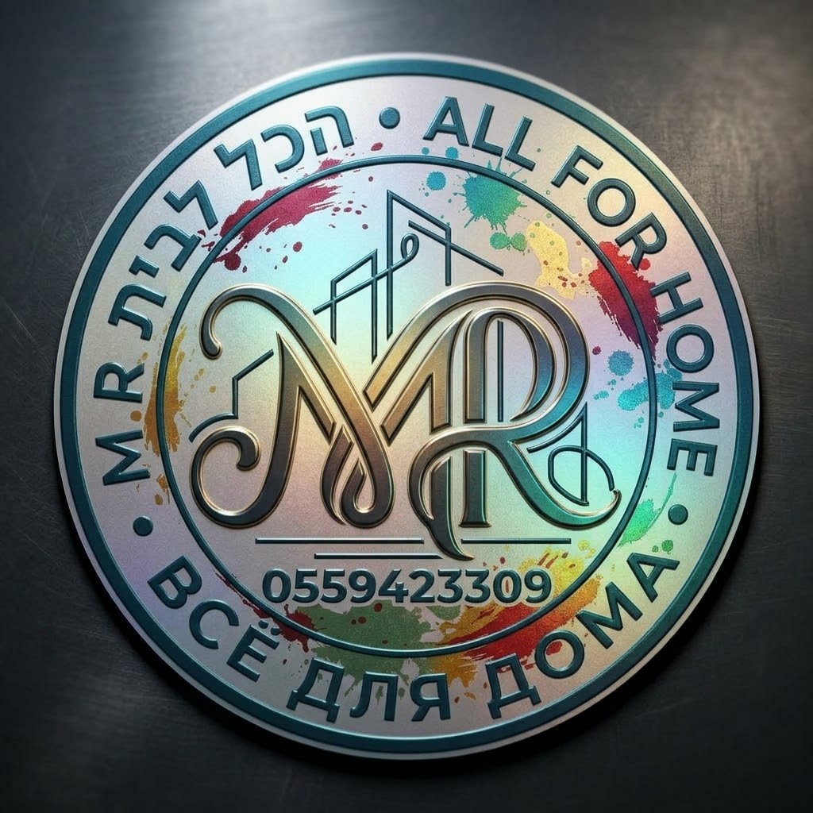

<!DOCTYPE html>
<html lang="he" dir="rtl">
<head>
    <meta charset="UTF-8">
    <meta name="viewport" content="width=device-width, initial-scale=1.0">
    <title>M.R. הכל לבית</title>
    
    <!-- Firebase SDKs -->
    
    

    
</head>
<body>

    

        <!-- כרטיס ביקור מוגדל ומרובע -->
        

            
        

        <!-- הלוגו מרובע, מוגדל וללא מסגרת כחולה -->
        
    

    <h1>M.R. הכל לבית</h1>
    
שירות מקיף, מקצועי ומהיר בכל מקום בישראל

    <!-- כפתורי תקשורת וחתימה גדולה וברורה -->
    

        

            <a href="https://wa.me/972559423309?text=שלום%2C%20אשמח%20לקבל%20פרטים%20נוספים" class="social-btn whatsapp-btn">💬 WhatsApp · 055-9423309</a>
            <a href="https://www.instagram.com/m.r26420" target="_blank" class="social-btn instagram-btn">📸 Instagram @m.r26420</a>
            <a href="https://www.tiktok.com/@m.r26420" target="_blank" class="social-btn tiktok-btn">🎵 TikTok @m.r26420</a>
        

        

            חתימת העסק:
            
        

    

    <h2>בחרו שירות</h2>
    

        <a class="btn" href="https://wa.me/972559423309?text=שלום%2C%20אני%20מעוניין%20בעבודת%20אינסטלציה.%20נא%20להביא%20לי%20בבקשה%20הצעת%20מחיר%2C%20מצורפות%20תמונות%20או%20וידאו%20או%20גם%20וגם%3A">🚰 אינסטלציה</a>
        <a class="btn" href="https://wa.me/972559423309?text=שלום%2C%20אני%20מעוניין%20בעבודת%20צבע.%20נא%20להביא%20לי%20בבקשה%20הצעת%20מחיר%2C%20מצורפות%20תמונות%20או%20וידאו%20או%20גם%20וגם%3A">🎨 צבע</a>
        <a class="btn" href="https://wa.me/972559423309?text=שלום%2C%20אני%20מעוניין%20בחידוש%20רהיטים.%20נא%20להביא%20לי%20בבקשה%20הצעת%20מחיר%2C%20מצורפות%20תמונות%20או%20וידאו%20או%20גם%20וגם%3A">🛋️ חידוש רהיטים</a>
        <a class="btn" href="https://wa.me/972559423309?text=שלום%2C%20אני%20מעוניין%20בניקיון.%20נא%20להביא%20לי%20בבקשה%20הצעת%20מחיר%2C%20מצורפות%20תמונות%20או%20וידאו%20או%20גם%20וגם%3A">🧹 ניקיון</a>
        <a class="btn" href="https://wa.me/972559423309?text=שלום%2C%20אני%20מעוניין%20בהריסות.%20נא%20להביא%20לי%20בבקשה%20הצעת%20מחיר%2C%20מצורפות%20תמונות%20או%20וידאו%20או%20גם%20וגם%3A">🧱 הריסות</a>
        <a class="btn" href="https://wa.me/972559423309?text=שלום%2C%20אני%20מעוניין%20בשיפוצים.%20נא%20להביא%20לי%20בבקשה%20הצעת%20מחיר%2C%20מצורפות%20תמונות%20או%20וידאו%20או%20גם%20וגם%3A">📐 שיפוצים</a>
        <a class="btn" href="https://wa.me/972559423309?text=שלום%2C%20אני%20מעוניין%20בעבודות%20גבס.%20נא%20להביא%20לי%20בבקשה%20הצעת%20מחיר%2C%20מצורפות%20תמונות%20או%20וידאו%20או%20גם%20וגם%3A">🪚 עבודות גבס</a>
    

    <h2>🚚 הובלות</h2>
    

        <a class="btn" href="https://wa.me/972559423309?text=שלום%2C%20אני%20מעוניין%20בהובלות%20גדולות.%20נא%20להביא%20לי%20בבקשה%20הצעת%20מחיר%2C%20מצורפות%20תמונות%20או%20וידאו%20או%20גם%20וגם%3A">🚛 הובלות גדולות</a>
        <a class="btn" href="https://wa.me/972559423309?text=שלום%2C%20אני%20מעוניין%20בהובלות%20קטנות.%20נא%20להביא%20לי%20בבקשה%20הצעת%20מחיר%2C%20מצורפות%20תמונות%20או%20וידאו%20או%20גם%20וגם%3A">📦 הובלות קטנות</a>
        <a class="btn" href="https://wa.me/972559423309?text=שלום%2C%20אני%20מעוניין%20בהובלת%20רהיט%20אחד.%20נא%20להביא%20לי%20בבקשה%20הצעת%20מחיר%2C%20מצורפות%20תמונות%20או%20וידאו%20או%20גם%20וגם%3A">🛋️ הובלת רהיט אחד</a>
        <a class="btn" href="https://wa.me/972559423309?text=שלום%2C%20אני%20מעוניין%20בהובלות%20משרדים.%20נא%20להביא%20לי%20בבקשה%20הצעת%20מחיר%2C%20מצורפות%20תמונות%20או%20וידאו%20או%20גם%20וגם%3A">🏢 הובלות משרדים</a>
    

    <!-- אזור תגובות -->
    

        <h2>⭐ תגובות לקוחות ודירוגים</h2>
        <h3>✍️ השאר תגובה ודרג אותנו:</h3>
        
        <form id="reviewForm">
            

                <label for="reviewerName">שם מלא:</label>
                <input type="text" id="reviewerName" required placeholder="הכנס את שמך">
            

            

                <label for="reviewCategory">בחר קטגוריה:</label>
                <select id="reviewCategory" required>
                    <option value="">בחר שירות...</option>
                    <option value="אינסטלציה">אינסטלציה</option>
                    <option value="צבע">צבע</option>
                    <option value="חידוש רהיטים">חידוש רהיטים</option>
                    <option value="ניקיון">ניקיון</option>
                    <option value="הריסות">הריסות</option>
                    <option value="שיפוצים">שיפוצים</option>
                    <option value="עבודות גבס">עבודות גבס</option>
                    <option value="הובלות גדולות">הובלות גדולות</option>
                    <option value="הובלות קטנות">הובלות קטנות</option>
                    <option value="הובלת רהיט אחד">הובלת רהיט אחד</option>
                    <option value="הובלות משרדים">הובלות משרדים</option>
                </select>
            

            

                <label>דירוג כוכבים (לחץ על כוכב לבחירה):</label>
                

                    ★
                    ★
                    ★
                    ★
                    ★
                    ★
                    ★
                    ★
                    ★
                    ★
                

                
דירוג נבחר: 5 מתוך 5 כוכבים

                <input type="hidden" id="reviewRating" value="5" required>
            

            

                <label for="reviewText">התגובה שלך:</label>
                <textarea id="reviewText" rows="3" required placeholder="כתוב כאן את חוות דעתך..."></textarea>
            

            

                <label for="reviewImages">צרף תמונות להוכחת העבודה (עד 10 תמונות):</label>
                <input type="file" id="reviewImages" accept="image/*" multiple>
            

            <button type="submit" class="btn" id="submitBtn" style="background: #28a745; width: 100%; border: none; cursor: pointer; font-size: 16px;">פרסם תגובה באתר ושלח לוואטסאפ 🚀</button>
        </form>

        

            

                <label for="filterCategory" style="font-weight: bold; margin-left: 10px;">סנן תגובות לפי קטגוריה:</label>
                <select id="filterCategory" onchange="renderReviews()" style="width: 200px; padding: 5px;">
                    <option value="all">הצג הכל</option>
                    <option value="אינסטלציה">אינסטלציה</option>
                    <option value="צבע">צבע</option>
                    <option value="חידוש רהיטים">חידוש רהיטים</option>
                    <option value="ניקיון">ניקיון</option>
                    <option value="הריסות">הריסות</option>
                    <option value="שיפוצים">שיפוצים</option>
                    <option value="עבודות גבס">עבודות גבס</option>
                    <option value="הובלות גדולות">הובלות גדולות</option>
                    <option value="הובלות קטנות">הובלות קטנות</option>
                    <option value="הובלת רהיט אחד">הובלת רהיט אחד</option>
                    <option value="הובלות משרדים">הובלות משרדים</option>
                </select>
            

            

                
טוען תגובות...

            

        

    

    <footer>Matan Richter © M.R. הכל לבית</footer>

</body>
</html>
