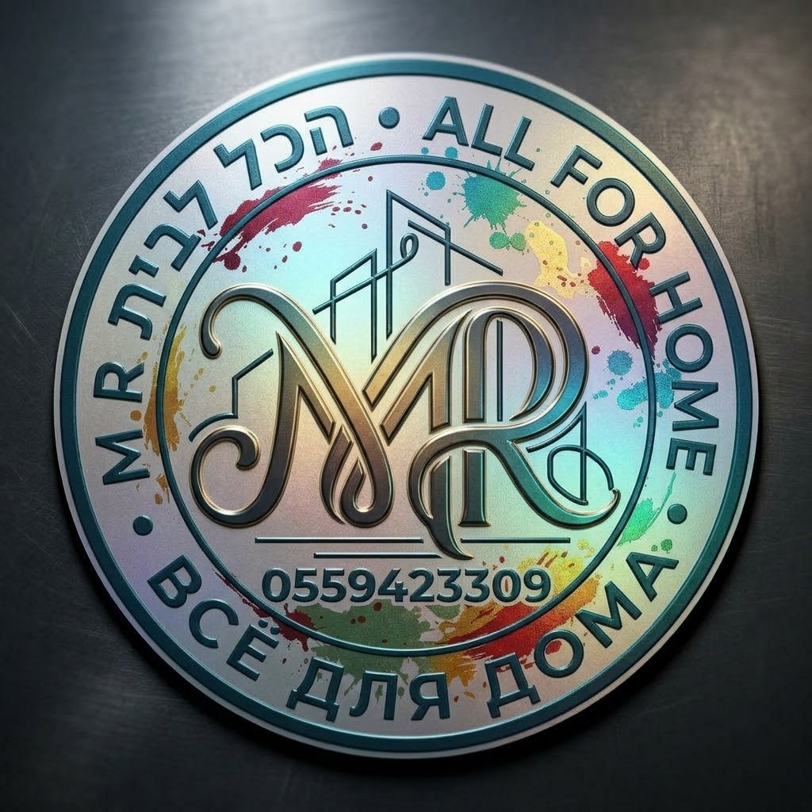

>M.R הכול השירותים לבית
<html lang="he" dir="rtl">
  <meta charset="UTF-8">
  <meta name="viewport" content="width=device-width, initial-scale=1.0">
  <title>M.R הכול השירותים לבית</title>
  
</head>

    <meta charset="UTF-8">
    <meta name="viewport" content="width=device-width, initial-scale=1.0">
    <title>M.R. הכל לבית</title>
    <meta name="description" content="M.R. הכל לבית – אינסטלציה, חשמל, צבע, שיפוצים, הובלות וניקיון מקרית שמונה ועד באר שבע. Услуги по дому от Кирьят-Шмоны до Беэр-Шевы.">

    <meta property="og:title" content="M.R. הכל לבית – שיפוצים, אינסטלציה, חשמל והובלות">
    <meta property="og:description" content="שירות מקיף, מקצועי ומהיר מקרית שמונה ועד באר שבע">
    <meta property="og:type" content="website">
    <meta name="theme-color" content="#007bff">

    <!-- נתונים מובנים לגוגל -->
    

    <!-- Firebase SDKs -->
    
    

    
</head>
<body>

    <!-- החלפת שפה -->
    

        <button type="button" id="btn-he" class="on" onclick="setLang('he')">עברית</button>
        <button type="button" id="btn-ru" onclick="setLang('ru')">Русский</button>
    

    

        

            
        

        
    

    <h1>M.R. הכל לבית</h1>
    
שירות מקיף, מקצועי ומהיר מקרית שמונה ועד באר שבע

    <!-- כפתורי תקשורת וחתימה -->
    

        

            <a href="https://wa.me/972559423309?text=שלום%2C%20אשמח%20לקבל%20פרטים%20נוספים" target="_blank" rel="noopener" class="social-btn whatsapp-btn">💬 WhatsApp · 055-9423309</a>
            <a href="tel:+972559423309" class="social-btn call-btn">📞 התקשר עכשיו</a>
            <a href="https://www.instagram.com/m.r26420" target="_blank" rel="noopener" class="social-btn instagram-btn">📸 Instagram @m.r26420</a>
            <a href="https://www.tiktok.com/@m.r26420" target="_blank" rel="noopener" class="social-btn tiktok-btn">🎵 TikTok @m.r26420</a>
        

        

            חתימת העסק:
            
        

    

    <h2 data-ru="Выберите услугу">בחרו שירות</h2>
    

        <a class="btn" data-ru="🚰 Сантехника" href="https://wa.me/972559423309?text=שלום%2C%20אני%20מעוניין%20בעבודת%20אינסטלציה.%20נא%20להביא%20לי%20בבקשה%20הצעת%20מחיר%2C%20מצורפות%20תמונות%20או%20וידאו%20או%20גם%20וגם%3A">🚰 אינסטלציה</a>
        <a class="btn" data-ru="⚡ Электрика" href="https://wa.me/972559423309?text=שלום%2C%20אני%20מעוניין%20בעבודות%20חשמל.%20נא%20להביא%20לי%20בבקשה%20הצעת%20מחיר%2C%20מצורפות%20תמונות%20או%20וידאו%20או%20גם%20וגם%3A">⚡ חשמל</a>
        <a class="btn" data-ru="🎨 Покраска" href="https://wa.me/972559423309?text=שלום%2C%20אני%20מעוניין%20בעבודת%20צבע.%20נא%20להביא%20לי%20בבקשה%20הצעת%20מחיר%2C%20מצורפות%20תמונות%20או%20וידאו%20או%20גם%20וגם%3A">🎨 צבע</a>
        <a class="btn" data-ru="🛋️ Реставрация мебели" href="https://wa.me/972559423309?text=שלום%2C%20אני%20מעוניין%20בחידוש%20רהיטים.%20נא%20להביא%20לי%20בבקשה%20הצעת%20מחיר%2C%20מצורפות%20תמונות%20או%20וידאו%20או%20גם%20וגם%3A">🛋️ חידוש רהיטים</a>
        <a class="btn" data-ru="🧹 Уборка" href="https://wa.me/972559423309?text=שלום%2C%20אני%20מעוניין%20בניקיון.%20נא%20להביא%20לי%20בבקשה%20הצעת%20מחיר%2C%20מצורפות%20תמונות%20או%20וידאו%20או%20גם%20וגם%3A">🧹 ניקיון</a>
        <a class="btn" data-ru="🧱 Демонтаж" href="https://wa.me/972559423309?text=שלום%2C%20אני%20מעוניין%20בהריסות.%20נא%20להביא%20לי%20בבקשה%20הצעת%20מחיר%2C%20מצורפות%20תמונות%20או%20וידאו%20או%20גם%20וגם%3A">🧱 הריסות</a>
        <a class="btn" data-ru="📐 Ремонт" href="https://wa.me/972559423309?text=שלום%2C%20אני%20מעוניין%20בשיפוצים.%20נא%20להביא%20לי%20בבקשה%20הצעת%20מחיר%2C%20מצורפות%20תמונות%20או%20וידאו%20או%20גם%20וגם%3A">📐 שיפוצים</a>
        <a class="btn" data-ru="🪚 Гипсокартон" href="https://wa.me/972559423309?text=שלום%2C%20אני%20מעוניין%20בעבודות%20גבס.%20נא%20להביא%20לי%20בבקשה%20הצעת%20מחיר%2C%20מצורפות%20תמונות%20או%20וידאו%20או%20גם%20וגם%3A">🪚 עבודות גבס</a>
    

    <h2 data-ru="🚚 Перевозки">🚚 הובלות</h2>
    

        <a class="btn" data-ru="🚛 Большие перевозки" href="https://wa.me/972559423309?text=שלום%2C%20אני%20מעוניין%20בהובלות%20גדולות.%20נא%20להביא%20לי%20בבקשה%20הצעת%20מחיר%2C%20מצורפות%20תמונות%20או%20וידאו%20או%20גם%20וגם%3A">🚛 הובלות גדולות</a>
        <a class="btn" data-ru="📦 Малые перевозки" href="https://wa.me/972559423309?text=שלום%2C%20אני%20מעוניין%20בהובלות%20קטנות.%20נא%20להביא%20לי%20בבקשה%20הצעת%20מחיר%2C%20מצורפות%20תמונות%20או%20וידאו%20או%20גם%20וגם%3A">📦 הובלות קטנות</a>
        <a class="btn" data-ru="🛋️ Перевозка одного предмета мебели" href="https://wa.me/972559423309?text=שלום%2C%20אני%20מעוניין%20בהובלת%20רהיט%20אחד.%20נא%20להביא%20לי%20בבקשה%20הצעת%20מחיר%2C%20מצורפות%20תמונות%20או%20וידאו%20או%20גם%20וגם%3A">🛋️ הובלת רהיט אחד</a>
        <a class="btn" data-ru="🏢 Перевозки офисов" href="https://wa.me/972559423309?text=שלום%2C%20אני%20מעוניין%20בהובלות%20משרדים.%20נא%20להביא%20לי%20בבקשה%20הצעת%20מחיר%2C%20מצורפות%20תמונות%20או%20וידאו%20או%20גם%20וגם%3A">🏢 הובלות משרדים</a>
    

    <h2 data-ru="📍 Район работы">📍 אזור פעילות</h2>
    
от Кирьят-Шмоны до Беэр-Шевы</b>">אנחנו פעילים <b>מקרית שמונה ועד באר שבע</b>

    <h2 data-ru="🕒 Часы работы">🕒 שעות פעילות</h2>
    

        
ראשון – חמישי<b>08:00 – 20:00</b>

        
שישי<b>09:00 – 14:00</b>

        
שבת<b style="color:#a12727" data-ru="Только экстренные случаи">מקרה חירום בלבד</b>

    

    <!-- שירות חירום -->
    <h2 data-ru="🚨 Срочный вызов">🚨 שירות חירום</h2>
    

        <h3 data-ru="Что включает срочный вызов и как подготовиться заранее:">מה כולל שירות חירום ואיך נערכים מראש:</h3>
        <ul class="emergency-tips" data-ru="<li><b>Когда обращаться:</b> протечка/прорыв воды, короткое замыкание или искрение, срочный ремонт или экстренная перевозка.</li><li><b>Как мы работаем:</b> быстрая оценка ситуации и выезд по возможности, прозрачное согласование условий заранее.</li><li><b>Что отправить сразу:</b> город, этаж/доступ и фото или видео проблемы (если это безопасно).</li>">
            <li><b>מתי פונים:</b> פיצוץ מים או נזילה פעילה, קצר/תקלת חשמל, מפגע בטיחותי או הובלה דחופה.</li>
            <li><b>איך זה עובד:</b> תעדוף מהיר, בירור פרטים מראש ותיאום ברור לפני יציאה/תחילת עבודה.</li>
            <li><b>מה כדאי לשלוח מיד:</b> עיר וכתובת/קומה, ותמונה או סרטון קצר (רק אם בטוח לצלם).</li>
        </ul>

        

            <label for="emergencyType" data-ru="Тип экстренного случая:">סוג קריאת החירום:</label>
            <select id="emergencyType">
                <option value="נזילה / פיצוץ מים" data-ru="Прорыв воды / утечка">נזילה / פיצוץ מים</option>
                <option value="תקלת חשמל / קצר" data-ru="Проблема с электричеством / замыкание">תקלת חשמל / קצר</option>
                <option value="מפגע / תיקון דחוף" data-ru="Срочный ремонт / опасность">מפגע / תיקון דחוף</option>
                <option value="הובלה / פינוי דחוף" data-ru="Срочная перевозка">הובלה / פינוי דחוף</option>
            </select>
        

        

            <label for="emergencyCity" data-ru="Город и район:">עיר / אזור:</label>
            <input type="text" id="emergencyCity" placeholder="למשל: כרמיאל / חיפה / צפון" data-ru-ph="Например: Кармиэль, Хайфа...">
        

        

            <a id="emergencyWaBtn" href="https://wa.me/972559423309" target="_blank" rel="noopener" class="social-btn emergency-wa-btn">
                🚨 שלח קריאת חירום בוואטסאפ
            </a>
            <a href="tel:+972559423309" class="social-btn call-btn">
                📞 חיוג חירום מיידי
            </a>
        

    

    <!-- גלריית עבודות לפני ואחרי -->
    

        <h2 style="margin-top: 0;" data-ru="📸 Галерея работ: До и После">📸 גלריית עבודות: לפני ואחרי</h2>

        <button type="button" class="gallery-toggle-btn" id="toggleGalleryUploadBtn" data-ru="➕ Добавить фото работы (До / После)">
            ➕ הוסף תמונות עבודה (לפני / אחרי)
        </button>

        

            <h3 style="margin-top: 0; color: #007bff;" data-ru="Загрузить новую работу в галерею:">העלאת עבודה חדשה לגלריה:</h3>
            <form id="galleryForm">
                

                    <label for="galleryPin" data-ru="Пароль администратора:">קוד מנהל (לבעל העסק בלבד):</label>
                    <input type="password" id="galleryPin" required placeholder="הכנס קוד מנהל" data-ru-ph="Введите пароль">
                

                

                    <label for="galleryCategory" data-ru="Категория работы:">קטגוריית העבודה:</label>
                    <select id="galleryCategory" required>
                        <option value="" data-ru="Выберите услугу...">בחר שירות...</option>
                        <option value="אינסטלציה" data-ru="Сантехника">אינסטלציה</option>
                        <option value="חשמל" data-ru="Электрика">חשמל</option>
                        <option value="צבע" data-ru="Покраска">צבע</option>
                        <option value="חידוש רהיטים" data-ru="Реставрация мебели">חידוש רהיטים</option>
                        <option value="ניקיון" data-ru="Уборка">ניקיון</option>
                        <option value="הריסות" data-ru="Демонтаж">הריסות</option>
                        <option value="שיפוצים" data-ru="Ремонт">שיפוצים</option>
                        <option value="עבודות גבס" data-ru="Гипсокартон">עבודות גבס</option>
                        <option value="הובלות גדולות" data-ru="Большие перевозки">הובלות גדולות</option>
                        <option value="הובלות קטנות" data-ru="Малые перевозки">הובלות קטנות</option>
                        <option value="הובלת רהיט אחד" data-ru="Перевозка одного предмета мебели">הובלת רהיט אחד</option>
                        <option value="הובלות משרדים" data-ru="Перевозки офисов">הובלות משרדים</option>
                    </select>
                

                

                    <label for="galleryTitle" data-ru="Краткое описание работы:">תיאור קצר של העבודה:</label>
                    <input type="text" id="galleryTitle" required placeholder="למשל: שיפוץ חדר אמבטיה / צביעת דירה בכרמיאל" data-ru-ph="Например: Ремонт ванной / Покраска квартиры">
                

                

                    <label for="beforeImages" data-ru="Фото/видео ДО работы (до 10 файлов):">תמונות / סרטונים לפני העבודה (עד 10 קבצים):</label>
                    <input type="file" id="beforeImages" accept="image/*,video/*" multiple required>
                

                

                    <label for="afterImages" data-ru="Фото/видео ПОСЛЕ работы (до 10 файлов):">תמונות / סרטונים אחרי העבודה (עד 10 קבצים):</label>
                    <input type="file" id="afterImages" accept="image/*,video/*" multiple required>
                

                <button type="submit" class="btn" id="gallerySubmitBtn" style="background: #007bff; width: 100%; border: none; cursor: pointer; font-size: 16px;"></button>
            </form>
        

        

            <label for="filterGalleryCategory" style="font-weight: bold; margin-left: 10px;" data-ru="Фильтр галереи по категории:">סנן עבודות לפי קטגוריה:</label>
            <select id="filterGalleryCategory" onchange="renderGallery()" style="width: 200px; padding: 5px;">
                <option value="all" data-ru="Показать все">הצג הכל</option>
                <option value="אינסטלציה" data-ru="Сантехника">אינסטלציה</option>
                <option value="חשמל" data-ru="Электрика">חשמל</option>
                <option value="צבע" data-ru="Покраска">צבע</option>
                <option value="חידוש רהיטים" data-ru="Реставрация мебели">חידוש רהיטים</option>
                <option value="ניקיון" data-ru="Уборка">ניקיון</option>
                <option value="הריסות" data-ru="Демонтаж">הריסות</option>
                <option value="שיפוצים" data-ru="Ремонт">שיפוצים</option>
                <option value="עבודות גבס" data-ru="Гипсокартон">עבודות גבס</option>
                <option value="הובלות גדולות" data-ru="Большие перевозки">הובלות גדולות</option>
                <option value="הובלות קטנות" data-ru="Малые перевозки">הובלות קטנות</option>
                <option value="הובלת רהיט אחד" data-ru="Перевозка одного предмета мебели">הובלת רהיט אחד</option>
                <option value="הובלות משרדים" data-ru="Перевозки офисов">הובלות משרדים</option>
            </select>
        

        

    

    <!-- שאלות נפוצות -->
    <h2 data-ru="❓ Частые вопросы">❓ שאלות נפוצות</h2>
    

        

            
איך מקבלים הצעת מחיר ומה כדאי לשלוח?

            
Нажмите на кнопку нужной услуги – откроется WhatsApp с готовым сообщением. Отправьте:
<ul><li>Короткое описание работы</li><li>Фото или видео</li><li>Город и адрес</li><li>Желаемую дату и срочность</li></ul>
Для перевозок также: адрес загрузки и выгрузки, этаж и лифт, список вещей.
">
                
לוחצים על כפתור השירות הרצוי ונפתח וואטסאפ עם הודעה מוכנה. כדאי לשלוח:

                <ul>
                    <li>תיאור קצר של העבודה</li>
                    <li>תמונות או וידאו</li>
                    <li>עיר וכתובת</li>
                    <li>תאריך מבוקש והאם זה דחוף</li>
                </ul>
                
להובלות גם: כתובת איסוף ויעד, קומה ומעלית, ורשימת פריטים.

            

        

        

            
באילו אזורים ובאילו שעות אתם עובדים?

            
מקרית שמונה ועד באר שבע. ראשון–חמישי 8:00–20:00, שישי 9:00–14:00.

        

        

            
האם עובדים בשבת ובמקרים דחופים?

            
בשבת אנחנו עובדים במקרי חירום בלבד. שלחו הודעה בוואטסאפ וכתבו שזה דחוף.

        

    

    <!-- אזור תגובות -->
    

        <h2 data-ru="⭐ Отзывы клиентов и оценки">⭐ תגובות לקוחות ודירוגים</h2>
        <h3 data-ru="✍️ Оставьте отзыв и оцените нас:">✍️ השאר תגובה ודרג אותנו:</h3>

        <form id="reviewForm">
            

                <label for="reviewerName" data-ru="Полное имя:">שם מלא:</label>
                <input type="text" id="reviewerName" required placeholder="הכנס את שמך" data-ru-ph="Введите ваше имя">
            

            

                <label for="reviewCategory" data-ru="Выберите категорию:">בחר קטגוריה:</label>
                <select id="reviewCategory" required>
                    <option value="" data-ru="Выберите услугу...">בחר שירות...</option>
                    <option value="אינסטלציה" data-ru="Сантехника">אינסטלציה</option>
                    <option value="חשמל" data-ru="Электрика">חשמל</option>
                    <option value="צבע" data-ru="Покраска">צבע</option>
                    <option value="חידוש רהיטים" data-ru="Реставрация мебели">חידוש רהיטים</option>
                    <option value="ניקיון" data-ru="Уборка">ניקיון</option>
                    <option value="הריסות" data-ru="Демонтаж">הריסות</option>
                    <option value="שיפוצים" data-ru="Ремонт">שיפוצים</option>
                    <option value="עבודות גבס" data-ru="Гипсокартон">עבודות גבס</option>
                    <option value="הובלות גדולות" data-ru="Большие перевозки">הובלות גדולות</option>
                    <option value="הובלות קטנות" data-ru="Малые перевозки">הובלות קטנות</option>
                    <option value="הובלת רהיט אחד" data-ru="Перевозка одного предмета мебели">הובלת רהיט אחד</option>
                    <option value="הובלות משרדים" data-ru="Перевозки офисов">הובלות משרדים</option>
                </select>
            

            

                <label data-ru="Оценка звёздами (нажмите на звезду):">דירוג כוכבים (לחץ על כוכב לבחירה):</label>
                

                    ★★
                    ★★
                    ★★
                    ★★
                    ★★
                

                
לחיצה על חצי כוכב בוחרת חצי דירוג

                

                <input type="hidden" id="reviewRating" value="5" required>
            

            

                <label for="reviewText" data-ru="Ваш отзыв:">התגובה שלך:</label>
                <textarea id="reviewText" rows="3" required placeholder="כתוב כאן את חוות דעתך..." data-ru-ph="Напишите здесь свой отзыв..."></textarea>
            

            

                <label for="reviewImages" data-ru="Прикрепите фото или видео работы (до 10 файлов):">צרף תמונות או סרטונים להוכחת העבודה (עד 10 קבצים):</label>
                <input type="file" id="reviewImages" accept="image/*,video/*" multiple>
            

            <button type="submit" class="btn" id="submitBtn" style="background: #28a745; width: 100%; border: none; cursor: pointer; font-size: 16px;"></button>
        </form>

        

            
רוצים לכתוב עלינו גם בגוגל או ב-144?

            

                <a class="social-btn google-btn" href="https://www.google.com/maps?cid=16449588355030326794" target="_blank" rel="noopener" data-ru="⭐ Отзыв в Google">⭐ ביקורת בגוגל</a>
                <a class="social-btn b144-btn" href="https://www.b144.co.il/b144_sip/401D0D1A4370655D4011001240/" target="_blank" rel="noopener" data-ru="📒 Отзыв в 144">📒 ביקורת ב-144</a>
            

        

        

            

                <label for="filterCategory" style="font-weight: bold; margin-left: 10px;" data-ru="Фильтр отзывов по категории:">סנן תגובות לפי קטגוריה:</label>
                <select id="filterCategory" onchange="renderReviews()" style="width: 200px; padding: 5px;">
                    <option value="all" data-ru="Показать все">הצג הכל</option>
                    <option value="אינסטלציה" data-ru="Сантехника">אינסטלציה</option>
                    <option value="חשמל" data-ru="Электрика">חשמל</option>
                    <option value="צבע" data-ru="Покраска">צבע</option>
                    <option value="חידוש רהיטים" data-ru="Реставрация мебели">חידוש רהיטים</option>
                    <option value="ניקיון" data-ru="Уборка">ניקיון</option>
                    <option value="הריסות" data-ru="Демонтаж">הריסות</option>
                    <option value="שיפוצים" data-ru="Ремонт">שיפוצים</option>
                    <option value="עבודות גבס" data-ru="Гипсокартон">עבודות גבס</option>
                    <option value="הובלות גדולות" data-ru="Большие перевозки">הובלות גדולות</option>
                    <option value="הובלות קטנות" data-ru="Малые перевозки">הובלות קטנות</option>
                    <option value="הובלת רהיט אחד" data-ru="Перевозка одного предмета мебели">הובלת רהיט אחד</option>
                    <option value="הובלות משרדים" data-ru="Перевозки офисов">הובלות משרדים</option>
                </select>
            

            

        

    

    <footer>Matan Richter © M.R. הכל לבית</footer>

<!-- חלון הגדלה לתמונה או סרטון -->

    
    <video id="lightboxVideo" src="" controls playsinline style="display: none;"></video>

</body>
</html>
